# AIDAScriptEncoder

A small web page that turns text into **AIDAScript**, a constructed writing system made of straight strokes, and lets you download the result as an **SVG** or **PNG** image.

**Try it here: https://dragonfolder.github.io/AIDAScriptEncoder/**

Type into the text box and the drawing updates as you type. There's nothing to install.

## Features

- Live preview, with zoom (25%–400%): point at a letter (or tap it) to see what it says
- The text is kept inside the downloads: as the SVG's title, and as the PNG's description
- Download as SVG or PNG, or copy the image to paste it anywhere
- **Copy link**: a link that opens exactly this drawing (text, settings and layout)
- Your settings are remembered in your browser for next time (**Reset to defaults** clears them)
- Long lines wrap into new columns, keeping words whole
- Settings for size, spacing, colors and layout
- **How to read AIDAScript**, at the bottom of the page: every letter, digit and punctuation mark (click a letter or digit to type it)
- A **compact** layout that packs the text into a tight blob, guided by a shape of your choice
- **Sigils** (in the navbar): turn a sentence into a sigil, just for fun

## How AIDAScript works

Each line of text becomes a **column**, read from top to bottom. Columns go from left to right.

Every letter is **two strokes** going out from its middle point, each in one of eight directions. Upper and lower case look the same.

```
NW  N  NE
  \ | /
W — · — E
  / | \
SW  S  SE
```

| **a** | **b** | **c** | **d** | **e** | **f** | **g** |
|:---:|:---:|:---:|:---:|:---:|:---:|:---:|
|  | 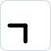 |  |  |  |  |  |

| **h** | **i** | **j** | **k** | **l** | **m** | **n** |
|:---:|:---:|:---:|:---:|:---:|:---:|:---:|
| 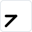 |  |  |  |  |  |  |

| **o** | **p** | **q** | **r** | **s** | **t** | **u** |
|:---:|:---:|:---:|:---:|:---:|:---:|:---:|
|  |  |  | 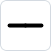 |  |  |  |

| **v** | **w** | **x** | **y** | **z** |
|:---:|:---:|:---:|:---:|:---:|
|  |  |  |  |  |

*(Drawn from the `LETTERS` table by `tools/make-letter-images.js`, like the digits and punctuation below.)*

Letters are stacked so their strokes connect without crossing in the wrong places. Words are separated by a gap.

Digits are **one stroke**, pointing from the middle to where the digit sits on a phone keypad. **2** and **8**, which lie on the middle line, get a bar across their middle end (2 is ⊥, 8 is T); **5**, the middle key, is a **+**, and **0**, below the keypad, is a diamond. Most digits are told apart by which side of the middle line they're on (4 is left of it, 6 right of it), so a number made only of 1, 4 and 7, or only of 3, 6 and 9, gets a short line along the middle to show where it is.

Digits stand apart from letters and punctuation. Within a number, each digit goes half a step below the one before it, and further down, half a step at a time, while:
- two lines would meet other than in an X at both their middles, with one line's tip on the other's middle, or tip to tip at least a full step apart (and not in a straight line);
- in a number with a middle line, two lines would cross less than a full step apart (that closes a tiny triangle against the middle line, as in 41);
- a line would touch the 0's diamond anywhere but a corner.

```
1  2  3        1 = NW   2 = N   3 = NE
 \ | /         4 = W    5 = +   6 = E
4 —+— 6        7 = SW   8 = S   9 = SE
 / | \         0 = ◇
7  8  9
   0
```

| **1** | **2** | **3** | **4** | **5** | **6** | **7** | **8** | **9** | **0** |
|:---:|:---:|:---:|:---:|:---:|:---:|:---:|:---:|:---:|:---:|
|  | 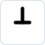 |  | 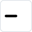 | 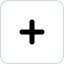 | 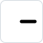 |  |  |  |  |

Punctuation marks are small shapes that stand apart and never touch anything. Quote marks open with **Λ** and close with **V**, and `"` is two of them, one above the other. An apostrophe inside a word (don't) is always Λ, as is a `'` that's never closed (the dogs'). Curly quotes (‘ ’ “ ”) work too. Parentheses open with a cap (⊓) and close with a cup (⊔); brackets `[ ]` and braces `{ }` draw the same way, and guillemets `« »` `‹ ›` draw as quote marks. Dashes (– —) draw as `-`, and `…` as `...`. Two quote marks in a row get an extra half line size between them, so '' doesn't read as ". The colon's two dots sit side by side, so it never looks like periods in a row.

| `.` | `,` | `'` (apostrophe, opening) | `'` (closing) | `"` (opening) | `"` (closing) | `?` | `!` |
|:---:|:---:|:---:|:---:|:---:|:---:|:---:|:---:|
|  |  | 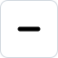 |  |  |  | 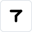 | 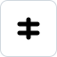 |

| `-` (also – —) | `:` | `;` | `(` | `)` | `/` |
|:---:|:---:|:---:|:---:|:---:|:---:|
|  | 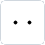 |  | 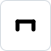 |  |  |

## Settings

| Setting | Default | What it does |
|---|---|---|
| Padding | 30 px | Space around the drawing |
| Line size | 20 px | Length of one stroke; sets the size of everything |
| Line spacing | 10 px | Gap between columns (rectangle only) |
| Maximum height | 400 px | How tall a column may get before wrapping (rectangle only) |
| Shape | Rectangle | **Rectangle**: plain columns. **Compact**: packs the text as tightly as possible, with overlapping columns that never touch |
| Guide shape | Circle | Compact only: the shape to aim for: circle, rectangle, hexagon, diamond or triangle |
| Width : height | 1 : 1 | Compact only: stretches the guide shape (a circle becomes an oval, the rectangle starts out square) |
| Rotation | 0° | Compact only: turns the guide shape, up to 180° |
| Fit to guide | Tightest | Compact only: from the tightest result to one that fills out the guide shape more closely |
| Extend free line ends | on | Compact only: lengthens strokes whose tips touch nothing (and either end of the N/S overlap marker), to fill empty space |
| Frame | None | Compact only: a border around the result: the **guide shape**, the **smallest rectangle**, or a **blob** (the tightest outline without dents, with rounded corners). Only the guide shape affects the layout |
| Frame color | same as line color | Compact only: the frame's color; untick **Same as line color** to pick a different one |
| Frame thickness | 5 px | Compact only: how thick the frame is drawn (the lines stay 5 px) |
| Show line guides | off | Compact only: shows where each column runs (preview only) |
| Transparent | off | No background: the downloaded PNG and SVG are see-through (the preview shows a checkerboard) |
| Line / background color | black / white | Colors of the drawing. **🎲 Random colors** picks line, second line, frame and background colors that go together (a random color-wheel harmony, mood and background style, always with clear contrast; the name of the combination shows next to the button); it leaves **Same as line color** as it is |
| Column colors | One color | Compact only: give every column the line color, or alternate it with the **second line color**, so overlapping columns are easy to tell apart |

**🎲 Surprise me**, above the preview, switches to the compact shape with a random guide shape, stretch, rotation, frame and colors, and shows a random one of the layouts found (the text and sizes stay as they are).

In the compact shape, the **‹ Layout 1 / N ›** buttons above the preview step through the best few different layouts for the same text.

## Sigils

Just for fun: the **Sigils** page (in the navbar) turns a sentence into a sigil. Each letter becomes a line between its two semaphore points on a circle, and the words join into one figure. A dot marks the first letter and a crossbar the last. The downloads don't contain the sentence.

## Project structure

| File | Contents |
|---|---|
| `index.html` | The encoder: page layout and settings panel |
| `pages/sigils.html` | The Sigils page |
| `sigils.html` | Sends the Sigils page's old address on to `pages/sigils.html` |
| `styles/index.css` | Styling for both pages (teal accent on top of Bootstrap) |
| `scripts/index.js` | The encoder: settings, drawing, preview, downloads, sharing, the alphabet |
| `scripts/layout.js` | Where every character goes: letter shapes, spacing rules, and both layouts |
| `scripts/layout-worker.js` | Runs the compact layout in the background, so the page never freezes |
| `scripts/colors.js` | The Random colors generator |
| `scripts/save.js` | Saving and copying the pictures, on phones and inside other apps' browsers too |
| `scripts/sigils.js` | The Sigils page: settings, preview, downloads |
| `scripts/sigil.js` | How a sentence becomes a sigil |
| `scripts/sigil-worker.js` | Works out sigils in the background |
| `scripts/gif.js` | Makes the animated GIF of a sigil being written |
| `tests/` | The tests (see [Testing](#testing)) |
| `images/` | The logo, the tab icon (`favicon.svg`), the picture shown when a link is shared (`social-preview.png`), and the letter, digit and punctuation pictures in this README |
| `tools/make-letter-images.js` | Redraws those pictures (`node tools/make-letter-images.js`) |

The pages load their scripts and stylesheet with `?v=` and a release name, so a browser never mixes new files with old ones it kept: change it in both pages with every release (the tests check they agree).

To change how a letter looks, edit the `LETTERS` table in `scripts/layout.js`; for digits, the `DIGITS` table; for punctuation (and the digits 0 and 5), the `PUNCTUATION` table. Then run `node tools/make-letter-images.js` to redraw the pictures above.

## Testing

Two sets of checks, worth running before merging into `main`:

- **`node tests/run-tests.js`** (about 15 seconds, needs [Node.js](https://nodejs.org/), nothing else): the layouts are the same as before (`tests/snapshots.json`), lines of different columns never touch, no guide shape makes the layout freeze, the guide shapes' sums agree, random colors stay readable, and sigils hold together.
  - `--full` also tries every Surprise me combination (a few minutes).
  - `--update` saves the current layouts as the expected ones. Use it after changing the layout on purpose, once you've checked the result in the page.
- **`tests/browser.html`**: open it through a local server (for example `python -m http.server` in the project folder, then `http://localhost:8000/tests/browser.html`) and press **Run the tests**. It clicks through the real page: drawing, the background worker, the frames, Random colors, Surprise me and Reset, and checks that the Sigils page draws. Nothing is downloaded.

## Known limitations

- Symbols other than the punctuation above (`#`, `%`, `&`, emoji, …) have no shape yet, and are drawn as a space, so `50%` doesn't run into the next word. Accented letters are drawn without their accents (é as e).
- A word whose picture is the same when flipped left to right looks exactly like its mirror word, unless something else in the column shows where the middle is: `ho` and `zw` (also `hio` and `zxw`). These are the only ones among all letter combinations up to four letters, and only "ho" is a word. The letters follow flag semaphore, so they're kept as they are.
- In the rectangle shape, a single word taller than the maximum height runs past it.
- The stroke width is fixed at 5 px.
- The compact shape takes a moment with long text (about a second for 600 characters). The page stays usable meanwhile, showing "Arranging…". Opened straight from a file, some browsers don't allow the background worker, and the page then pauses instead.
